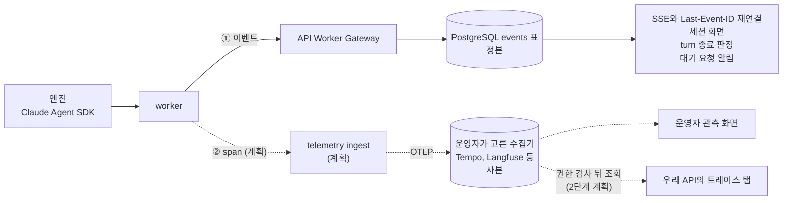

# 세션 데이터가 흐르는 길

worker가 엔진에서 받은 세션 데이터(모델 답변, 도구 호출과 결과, 권한 요청, 상태 변화)는 두 길로 나간다. ① DB의 `events` 표는 기능이 기대는 정본이고, 지금 동작한다. ② OpenTelemetry(OTel) 트레이스는 운영자가 보는 사본이고, 아직 구현 전이다. 이 문서는 두 길이 각각 무엇을 맡고, 무엇을 담고, 끊기면 무엇이 깨지는지, 누가 내용을 볼 수 있는지를 적는다.

**계획**이라고 표시한 문단과 표 칸은 아직 코드에 없다. 괄호 안의 Linear 티켓이 그 일을 맡는다(상위 설계 티켓 [94S-728](https://linear.app/94soon/issue/94S-728)). 표시가 없는 내용은 지금 main의 코드이고, 근거 파일을 함께 적는다. 지금의 감시(stdout JSON 로그, `/readyz`, DB query를 Datadog Agent가 수집)는 [monitoring-datadog.md](monitoring-datadog.md)에 있다. 지금 앱에는 OTel 의존성도 trace exporter도 없다.

## 한눈에

실선은 지금 있는 길이고 점선은 계획이다.

## 두 길의 역할

| | ① `events` 표 | ② OTel 트레이스 (계획) |
|---|---|---|
| 지위 | 정본 | 계획. 사본 |
| 지금 상태 | 동작한다 | 코드가 없다. 구현 뒤에도 기본값은 꺼짐이다(계획) |
| 담는 것 | `system`·`assistant`·`tool_use`·`tool_result`·`question`·`result`·`status`·`error` 이벤트 | 계획. turn, 모델 응답, 도구 실행, 권한 대기, 질문 대기, checkpoint의 시작·끝 시각, 토큰 수, 결과, 그리고 내용(아래 절) |
| 쓰는 곳 | 세션 화면, 공개 API 클라이언트, turn 종료 판정, 대기 요청 알림 | 계획. 운영자의 관측. 2단계에 세션 화면의 트레이스 탭 |
| 전달 | 같은 attempt 안에서 순서대로, 빈틈없이 저장해야 turn이 끝난다 | 계획. best effort. 큐가 넘치면 버리고 버린 수를 센다 |
| 끊기면 | 기능이 깨진다. SSE가 멈추고, turn을 finalize하지 못한다 | 계획. 관측만 빈다. 세션 실행과 화면은 그대로다 |
| 내용 길이 | worker가 따로 자르지 않는다 | 계획. 속성 하나 32KiB, turn 트레이스 하나 20MiB에서 자른다 |
| 받는 곳 | 우리 PostgreSQL | 계획. 운영자가 정한 OTLP 수집기 |

### ① `events` 표

이벤트 종류와 payload 계약은 `packages/contracts/src/api/event.ts`의 `SESSION_EVENT_NAMES`와 `sessionEventVariants`다. worker의 Claude adapter가 엔진 메시지를 이 이벤트로 바꾼다(`packages/adapters/runtimes/claude/src/mapper.ts`의 `projectPublicEvents`). assistant 메시지는 블록마다 이벤트 하나가 되고, 도구 결과 블록은 받은 그대로 `tool_result` 이벤트가 된다.

worker의 `EventPublisher`(`apps/worker/src/event-publisher.ts`)가 이벤트에 attempt 단위 `source_sequence`를 붙이고 Worker Gateway의 `/append-events`로 순서대로 보낸다. gateway가 받았다고 답하기 전에는 큐에서 지우지 않는다. API는 이벤트를 `events` 표(`packages/db/src/schema.ts`의 `events`)에 쓴다. 같은 attempt의 같은 sequence는 유일 인덱스 `events_attempt_sequence_uniq`가 한 번만 받는다.

이 표에 기대는 기능은 다음과 같다. 트레이스로는 이 기능들을 대신할 수 없다. 트레이스는 늦게 오고, 순서와 완전성을 보장하지 않고, 수집기가 없는 설치도 있다.

- **SSE와 재연결.** `apps/control-host/src/api/routes/events.ts`가 `Last-Event-ID` 다음부터 이 표를 읽어 스트림으로 보낸다. 사용법은 [api-guide.md § 5](api-guide.md#5-sse로-진행-보기와-last-event-id-재연결)에 있다.
- **turn 종료 판정.** 앞 sequence가 비어 있으면 `sequence_gap`, finalize할 때 이벤트가 덜 저장됐으면 `events_incomplete`로 거절한다(`packages/db/src/worker-unit-of-work.ts`, `packages/platform/src/workers/worker-gateway.ts`).
- **대기 요청 알림.** 질문·권한 요청의 `question` 이벤트와 세션의 `needs_input` 상태가 같은 트랜잭션에서 커밋된다. 그래서 클라이언트는 질문을 보기 전에 `needs_input`을 받지 않는다(`packages/db/src/pending-control.ts`). 답은 `pending_requests` 표에 남는다.
- **상태 전이.** 복구·재개·일시정지·interrupt 같은 제어 단계가 `recordStatus`·`recordEvent`(`packages/db/src/session-events.ts`)로 상태와 함께 커밋된다.
- **클라이언트의 작업 완료 판단.** 공개 API 클라이언트는 `assistant`·`tool_use`·`tool_result` 이벤트를 읽고 일이 끝났는지 판단한다([api-guide.md](api-guide.md)).

비용과 사용량의 정본은 이벤트가 아니라 `provider_usage` 표다. egress proxy가 Messages 응답에서 사용량을 읽고(`apps/egress-proxy/src/usage.ts`), API가 이 표에 쓴다(`packages/db/src/worker-unit-of-work.ts`).

### ② OTel 트레이스 (계획)

지금 `trace_id`는 `packages/observability/src/index.ts`의 `ObservabilityContext`에 필드만 있고 채우는 곳이 없다.

계획. 1단계에서는 worker가 span을 직접 만든다. worker는 엔진 메시지, PreToolUse·PostToolUse hook, `canUseTool` 권한 콜백(`packages/adapters/runtimes/claude/src/runtime.ts`)을 이미 모두 거치므로 그 자리에서 span을 만든다([94S-734](https://linear.app/94soon/issue/94S-734)). 트레이스는 turn 하나를 단위로 나누고, 같은 attempt의 turn끼리는 link로 잇는다. API는 HTTP 요청 span을 만들고, turn에 trace context를 저장해 worker에 넘긴다([94S-731](https://linear.app/94soon/issue/94S-731)). tracer와 OTLP exporter는 `packages/observability`에 두고, 같은 작업에서 로그 레코드의 `trace_id`도 채운다([94S-729](https://linear.app/94soon/issue/94S-729)).

계획. worker는 수집기로 직접 보내지 않는다. 수집기 credential을 worker에 두면 엔진의 도구가 읽을 수 있기 때문이다. worker는 API의 전용 telemetry ingest로 보내고, ingest가 세션·attempt를 검사하고 테넌트 속성을 다시 찍은 뒤 수집기로 넘긴다([94S-732](https://linear.app/94soon/issue/94S-732)). worker의 trace 큐는 이벤트 큐와 따로 두고 상한을 둔다. 그래서 트레이스 전송이 밀려도 이벤트 전송과 turn 진행은 기다리지 않는다.

엔진(Claude Code CLI) 자체의 telemetry는 1단계에서 쓰지 않는다. 지금 엔진에 넘기는 환경 변수는 allowlist이고(`packages/adapters/runtimes/claude/src/profile.ts`), OTel 변수는 하나도 넘기지 않는다. 계획. 엔진 telemetry를 붙이는 일은 2단계 선택 기능이다([94S-739](https://linear.app/94soon/issue/94S-739)).

### 수집기는 운영자가 고른다 (계획)

계획. API는 표준 OTLP로 내보낸다. OTLP를 받는 수집기면 어느 것이든 된다. Grafana Tempo, Langfuse, OpenTelemetry Collector, OTLP를 받는 상용 백엔드가 그 예다. 특정 벤더는 필요 없다. 운영자가 endpoint를 설정하기 전에는 export가 꺼져 있고, 꺼져 있어도 ① 경로와 세션 화면은 그대로 동작한다. 수집기 설정 키와 Tempo·Langfuse 설정 예시는 [94S-733](https://linear.app/94soon/issue/94S-733)과 [94S-737](https://linear.app/94soon/issue/94S-737)이 운영 문서에 더한다.

## 내용 수집과 비밀값 마스킹

### 무엇을 담나

① 이벤트는 지금도 내용을 담는다. assistant 텍스트, 도구 입력(`tool_use`), 도구 결과 본문(`tool_result`), 질문과 권한 요청의 입력이 들어간다(`packages/adapters/runtimes/claude/src/mapper.ts`의 `projectPublicEvents`·`pendingRequestEvent`).

② 트레이스(계획)는 export를 켠 설치에서 내용도 기본으로 싣는다. 사용자 입력은 turn span에, 답변 텍스트는 모델 응답 span에, 도구 입력과 출력은 도구 span에 실린다. thinking 블록은 싣지 않는다. 워크스페이스 설정으로 메타데이터(시각, 토큰 수, 도구 이름, 결과)만 보내도록 낮출 수 있다. 속성 하나는 UTF-8 32KiB에서 자르고, 자른 속성에는 잘렸다는 표시와 원래 바이트 수를 붙인다. turn 트레이스 하나가 20MiB를 넘으면 그 뒤 span에서는 내용을 빼고 메타데이터만 보낸다. 잘리지 않은 내용은 ① 이벤트에 남는다.

### 비밀값을 어디서 가리나

지금 규칙은 세 겹이다.

1. **엔진 메시지.** Claude adapter의 `sanitizeNativeMessage`(`packages/adapters/runtimes/claude/src/mapper.ts`)가 엔진 메시지마다 민감한 키의 값, `Bearer …` 같은 비밀 모양의 값, `password=…` 같은 이름 붙은 값을 `[REDACTED]`로 바꾼다. 이벤트는 이 결과로 만든다.
2. **claim이 준 비밀값.** worker의 `SecretScrubber`(`apps/worker/src/secret-scrubber.ts`)가 이 attempt에 받은 비밀값 자체를 찾아 `<redacted>`로 바꾼다. `scrubbingGateway`가 `appendEvents`와 `registerPending`에 이 처리를 건다. 엔진이 base64처럼 다시 인코딩한 값은 잡지 못한다.
3. **프로세스 로그.** `packages/observability/src/redaction.ts`의 `sanitizeText`·`sanitizeFields`가 API·worker의 stdout 로그를 가린다. egress proxy는 같은 파일의 사본 `apps/egress-proxy/src/redaction.ts`를 쓴다. 규칙 목록은 [operations.md § provider 키와 저장소 자격 증명](operations.md#provider-키와-저장소-자격-증명은-worker에-가지-않는다-94s-252)에 있다. 이 규칙은 로그용이고 이벤트에는 걸리지 않는다.

1과 3의 패턴 규칙은 내용 수집에 그대로 쓰기 어렵다. 로그 규칙 `sanitizeText`는 비밀 모양이나 `token=` 같은 조각을 하나라도 보면 문자열 전체를 `[REDACTED]`로 바꾼다. mapper는 대부분 일치한 구간만 바꾸고, `name=value` 꼴에서 값의 끝이 분명하면 값만 가린다. 그러나 mapper의 `hideNamedValues`도 `password: …`처럼 콜론으로 이어지는 값이나 끝을 가를 수 없는 값을 보면 텍스트 전체를 가린다. 그래서 `password:`가 든 YAML 파일을 Read한 도구 결과는 지금 이벤트에서도 통째로 사라진다. 두 파일의 패턴 목록도 서로 다르다. 그리고 로그 규칙의 키 패턴에는 맨 `token`이 있어서, 트레이스 속성에 그대로 걸면 토큰 수 속성까지 가려진다.

[94S-730](https://linear.app/94soon/issue/94S-730)(계획)이 이 규칙을 다시 쓴다. 일치한 구간만 가리고, 두 패턴 목록을 합치고, 이벤트와 트레이스가 같은 함수를 쓰게 한다. 메타데이터 속성 이름에는 허용 목록을 두어 키 규칙에서 뺀다. 트레이스 내용에도 `SecretScrubber`를 거친 뒤, ingest가 한 번 더 가린다. 엔진의 도구도 worker와 같은 네트워크에서 API를 부를 수 있으므로 ingest는 worker를 거쳤다고 믿지 않는다.

## 누가 내용을 보나

내용은 우리 API가 권한을 검사한 뒤 보여 준다. 고객이 수집기 화면에 직접 들어가는 구조가 아니다.

- **지금.** 세션 이벤트는 그 세션을 만든 주체(principal의 `ownerId`)만 `sessions:read` scope로 읽는다. 다른 주체의 세션은 404다(`apps/control-host/src/api/routes/events.ts`, `packages/platform/src/musterrolle/policy.ts`). scope는 HTTP 경계에서 `apps/control-host/src/api/scope-policy.ts`가 검사한다.
- **계획: 에이전트 오너와 관리 팀.** 에이전트 admin과 admin 팀 구성원이 그 에이전트의 세션 내용을 보게 하고, 열람마다 기록을 남긴다([94S-735](https://linear.app/94soon/issue/94S-735)). 팀과 권한 모델을 main에 반영하는 [JeongJaeSoon/agent-platform#427](https://github.com/JeongJaeSoon/agent-platform/pull/427) 위에 올린다. 권한은 열람할 때마다 다시 읽으므로, 팀에서 빠진 사람은 다음 요청부터 못 본다.
- **계획: 트레이스 상세 탭(2단계).** 우리 API가 위 권한을 검사한 뒤, 그 워크스페이스의 테넌트 안에서 세션 id와 turn의 trace id로 수집기를 조회해 보여 준다([94S-738](https://linear.app/94soon/issue/94S-738)). trace id만으로는 조회하지 않는다.
- **계획: 수집기 화면.** 수집기 UI에 직접 들어가는 사람은 운영자뿐이다. 수집기의 권한 단위(Langfuse의 프로젝트, Tempo의 테넌트)는 세션·에이전트 단위의 우리 규칙을 표현하지 못한다. 그래서 고객에게 수집기 계정을 주지 않는다. 워크스페이스는 테넌트 헤더나 워크스페이스별 키로 나눈다(속성 필터는 분리 수단이 아니다, [94S-732](https://linear.app/94soon/issue/94S-732)).

## 보존 기간으로 중복 저장 줄이기

계획대로 트레이스에 내용을 실으면 같은 내용이 ① DB와 ② 수집기에 두 번 저장된다. 정본은 ①이므로 ②의 내용은 오래 둘 필요가 없다.

- **① `events` 표.** 지금은 trim하지 않는다([api-guide.md](api-guide.md)의 410 `CURSOR_EXPIRED` 설명). 보존 기간 정책은 아직 정하지 않았고 맡은 티켓도 없다.
- **② 수집기(계획).** 내용이 든 데이터는 짧게, 메타데이터는 길게 두는 것을 권장값으로 둔다. 보존 기간은 수집기에서 운영자가 정한다. 설정 방법은 수집기마다 다르고, 판(edition)에 따라 없는 것도 있다. 수집기별 예시는 [94S-737](https://linear.app/94soon/issue/94S-737)이 더한다.
- **샘플링하지 않는다(계획).** worker 트레이스를 샘플링하면 내용과 유실 구간 대조가 빈다. 양은 속성 상한, 트레이스 상한, ingest의 분당 상한, 보존 기간으로 줄인다.

## 계획 티켓

아래 티켓은 모두 계획이고, main에 아직 구현이 없다.

| 티켓 | 하는 일 |
|---|---|
| [94S-729](https://linear.app/94soon/issue/94S-729) (T1) | OTel tracer 부트스트랩과 로그의 `trace_id` |
| [94S-731](https://linear.app/94soon/issue/94S-731) (T2) | API HTTP span과 turn의 trace context |
| [94S-734](https://linear.app/94soon/issue/94S-734) (T3) | worker span emitter |
| [94S-732](https://linear.app/94soon/issue/94S-732) (T4) | telemetry ingest listener |
| [94S-733](https://linear.app/94soon/issue/94S-733) (T5) | 운영자 설정 키와 claim telemetry 계약 |
| [94S-730](https://linear.app/94soon/issue/94S-730) (T6) | 비밀값 마스킹 규칙 재작성과 통합 |
| [94S-735](https://linear.app/94soon/issue/94S-735) (T7) | 에이전트 admin·admin 팀의 세션 열람 권한 |
| [94S-736](https://linear.app/94soon/issue/94S-736) (T8) | 복구 화면의 "덮이지 않은 활동" |
| [94S-737](https://linear.app/94soon/issue/94S-737) (T9) | 운영 문서와 수집기 예시 |
| [94S-738](https://linear.app/94soon/issue/94S-738) (T10, 2단계) | 트레이스 상세 탭 |
| [94S-739](https://linear.app/94soon/issue/94S-739) (T11, 2단계, 선택) | 엔진 CLI telemetry 추가 |
| [94S-740](https://linear.app/94soon/issue/94S-740) (T12) | 부수효과 도구의 `tool_use` durable 대기(결정 대기) |
