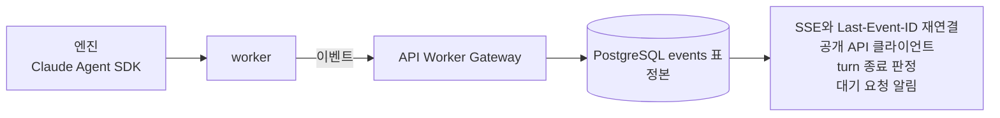

# 세션 데이터가 흐르는 길

worker가 엔진에서 받은 세션 데이터(모델 답변, 도구 호출과 결과, 권한 요청, 상태 변화)는 DB의 `events` 표로 간다. 이 표가 기능이 기대는 정본이다. 이 문서는 이 표가 무엇을 담고, 끊기면 무엇이 깨지는지, 비밀값을 어디서 가리는지, 누가 내용을 볼 수 있는지를 적고, OTLP 수집기 예제를 띄우는 법을 적는다. 내용마다 근거 파일을 함께 적는다.

지금의 감시(stdout JSON 로그, `/readyz`, DB query를 Datadog Agent가 수집)는 [monitoring-datadog.md](monitoring-datadog.md)에 있다. 앱에는 OpenTelemetry(OTel) 의존성도 trace exporter도 없다. 로그의 `trace_id`는 `packages/observability/src/index.ts`의 `ObservabilityContext`에 필드만 있고 채우는 곳이 없다.

## 한눈에



## `events` 표

| 항목 | 내용 |
|---|---|
| 담는 것 | `system`·`assistant`·`tool_use`·`tool_result`·`question`·`result`·`status`·`error` 이벤트 |
| 쓰는 곳 | 공개 API의 SSE 클라이언트, turn 종료 판정, 대기 요청 알림 |
| 전달 | 같은 attempt 안에서 순서대로, 빈틈없이 저장해야 turn이 끝난다 |
| 끊기면 | 기능이 깨진다. SSE가 멈추고, turn을 finalize하지 못한다 |
| 내용 길이 | worker가 따로 자르지 않는다 |
| 받는 곳 | 우리 PostgreSQL |

이벤트 종류와 payload 계약은 `packages/contracts/src/api/event.ts`의 `SESSION_EVENT_NAMES`와 `sessionEventVariants`다. worker의 Claude adapter가 엔진 메시지를 이 이벤트로 바꾼다(`packages/adapters/runtimes/claude/src/mapper.ts`의 `projectPublicEvents`). assistant 메시지는 블록마다 이벤트 하나가 되고, 도구 결과 블록은 받은 그대로 `tool_result` 이벤트가 된다.

worker의 `EventPublisher`(`apps/worker/src/event-publisher.ts`)가 이벤트에 attempt 단위 `source_sequence`를 붙이고 Worker Gateway의 `/append-events`로 순서대로 보낸다. gateway가 받았다고 답하기 전에는 큐에서 지우지 않는다. API는 이벤트를 `events` 표(`packages/db/src/schema.ts`의 `events`)에 쓴다. 같은 attempt의 같은 sequence는 유일 인덱스 `events_attempt_sequence_uniq`가 한 번만 받는다.

이 표에 기대는 기능은 다음과 같다.

- **SSE와 재연결.** `apps/control-host/src/api/routes/events.ts`가 `Last-Event-ID` 다음부터 이 표를 읽어 스트림으로 보낸다. 사용법은 [api-guide.md § 5](../api-guide.md#5-sse로-진행-보기와-last-event-id-재연결)에 있다.
- **turn 종료 판정.** 앞 sequence가 비어 있으면 `sequence_gap`, finalize할 때 이벤트가 덜 저장됐으면 `events_incomplete`로 거절한다(`packages/db/src/worker-unit-of-work.ts`, `packages/platform/src/workers/worker-gateway.ts`).
- **대기 요청 알림.** 질문·권한 요청의 `question` 이벤트와 세션의 `needs_input` 상태가 같은 트랜잭션에서 커밋된다. 그래서 클라이언트는 질문을 보기 전에 `needs_input`을 받지 않는다(`packages/db/src/pending-control.ts`). 답은 `pending_requests` 표에 남는다. worker가 요청을 어떻게 닫았는지도 같은 행에 남는다. `settled_outcome`은 `answered`·`expired`·`cancelled`다. `settled_reason`은 worker가 취소한 이유(`park`·`shutdown`·`interrupt`·`refused`)다. `settled_answer_result`는 런타임이 답을 어떻게 받았는지(`applied`·`stale`·`unknown`)다. 사람이 거절한 요청은 `answered`이고 `answer`의 `decision`이 `deny`라서 취소와 구분된다.
- **상태 전이.** 복구·재개·일시정지·interrupt 같은 제어 단계가 `recordStatus`·`recordEvent`(`packages/db/src/session-events.ts`)로 상태와 함께 커밋된다.
- **클라이언트의 작업 완료 판단.** 공개 API 클라이언트는 `assistant`·`tool_use`·`tool_result` 이벤트를 읽고 일이 끝났는지 판단한다([api-guide.md](../api-guide.md)).

비용과 사용량의 정본은 이벤트가 아니라 `provider_usage` 표다. egress proxy가 Messages 응답에서 사용량을 읽고(`apps/egress-proxy/src/usage.ts`), API가 이 표에 쓴다(`packages/db/src/worker-unit-of-work.ts`).

## 내용 수집과 비밀값 마스킹

### 무엇을 담나

이벤트는 내용을 담는다. assistant 텍스트, 도구 입력(`tool_use`), 도구 결과 본문(`tool_result`), 질문과 권한 요청의 입력이 들어간다(`packages/adapters/runtimes/claude/src/mapper.ts`의 `projectPublicEvents`·`approvalView`).

엔진(Claude Code CLI) 자체의 telemetry는 켜지 않는다. 엔진에 넘기는 환경 변수는 allowlist이고(`packages/adapters/runtimes/claude/src/profile.ts`), OTel 변수는 하나도 넘기지 않는다.

### 비밀값을 어디서 가리나

지금 규칙은 세 겹이다.

1. **엔진 메시지.** Claude adapter의 `sanitizeNativeMessage`(`packages/adapters/runtimes/claude/src/mapper.ts`)가 엔진 메시지마다 민감한 키의 값, `Bearer …` 같은 비밀 모양의 값, `password=…` 같은 이름 붙은 값을 `[REDACTED]`로 바꾼다. 이벤트는 이 결과로 만든다.
2. **claim이 준 비밀값.** worker의 `SecretScrubber`(`apps/worker/src/secret-scrubber.ts`)가 이 attempt에 받은 비밀값 자체를 찾아 `<redacted>`로 바꾼다. `scrubbingGateway`가 `appendEvents`와 `registerPending`에 이 처리를 건다. 엔진이 base64처럼 다시 인코딩한 값은 잡지 못한다.
3. **프로세스 로그.** `packages/observability/src/redaction.ts`의 `sanitizeText`·`sanitizeFields`가 API·worker의 stdout 로그를 가린다. egress proxy는 같은 파일의 사본 `apps/egress-proxy/src/redaction.ts`를 쓴다. 규칙 목록은 [api-server.md](api-server.md)의 'provider 키와 저장소 자격 증명은 worker에 가지 않는다' 절에 있다. 이 규칙은 로그용이고 이벤트에는 걸리지 않는다.

1과 3의 패턴 규칙은 가리는 범위가 다르다. 로그 규칙 `sanitizeText`는 비밀 모양이나 `token=` 같은 조각을 하나라도 보면 문자열 전체를 `[REDACTED]`로 바꾼다. mapper는 대부분 일치한 구간만 바꾸고, `name=value` 꼴에서 값의 끝이 분명하면 값만 가린다. 그러나 mapper의 `hideNamedValues`도 `password: …`처럼 콜론으로 이어지는 값이나 끝을 가를 수 없는 값을 보면 텍스트 전체를 가린다. 그래서 `password:`가 든 YAML 파일을 Read한 도구 결과는 이벤트에서 통째로 사라진다. 두 파일의 패턴 목록도 서로 다르다.

## 누가 내용을 보나

세션 이벤트는 `sessions:read` scope를 가진 주체가 그 세션을 볼 수 있을 때만 읽는다(`apps/control-host/src/api/routes/events.ts`, `packages/platform/src/musterrolle/policy.ts`). 먼저 세션이 주체와 같은 범위에 있어야 한다. 사람은 자기 workspace, API key는 그 key의 owner다(`packages/contracts/src/musterrolle/authorization.ts`의 `ownerScopeOf`). 그 안에서 세션의 공유 범위가 `workspace`(한 번도 바꾸지 않은 세션의 기본값)이면 workspace 구성원 모두가 읽고, `people`·`team`이면 만든 사람과 지정된 사람·팀 구성원만 읽는다. 개인 key는 그 key를 만든 사람으로 판정한다. 에이전트 key는 구성원이 아니라서 key 자신으로 판정하고(그 에이전트의 세션으로 한정된다), 자기가 만든 세션(만든 사람이 없는 세션)에서는 만든 사람 자리에 선다(`packages/platform/src/musterrolle/policy.ts`의 `viewerOf`, `packages/db/src/session-shares.ts`의 `sessionVisibleTo`). 볼 수 없는 세션은 404다. 공유 범위를 바꾸는 법과 owner·admin의 감사 열람은 [api-server.md](api-server.md)의 '세션 공유 범위와 감사 열람' 절에 있다. scope는 HTTP 경계에서 `apps/control-host/src/api/scope-policy.ts`가 검사한다.

## 보존 기간

`events` 표는 trim하지 않는다([api-guide.md](../api-guide.md)의 410 `CURSOR_EXPIRED` 설명). 보존 기간 정책은 아직 없다.

## 예제 수집기 띄우기

`infra/observability/`에 수집기 예제가 두 개 있다. 둘 다 Werft 스택과 따로 뜨는 compose project이고, 앞에 OpenTelemetry Collector를 하나씩 두어 표준 OTLP/HTTP를 받는다. 한 컴퓨터에서 OTLP 수신을 확인하는 용도이고, 운영 권장 구성이 아니다. 어느 수집기를 쓰고 어떻게 운영할지는 운영자가 정한다.

**볼 수 있는 범위.** Werft는 OTel 트레이스를 내보내지 않는다. Werft 세션을 실행해도 수집기에는 trace가 생기지 않는다. 이 절로 확인할 수 있는 것은 예제 수집기가 OTLP trace를 받아 화면에 보여 주는 데까지이고, 보내는 trace는 `send-test-span.sh`가 만든 가짜 span이다.

순서는 [띄우기](#띄우고-내리기) → [테스트 span 보내기](#테스트-span-보내기) → [화면에서 찾기](#화면에서-찾기) → [내리기](#띄우고-내리기)다. 예제 하나만 써도 된다.

| 예제 | 디렉터리 | OTLP/HTTP 받는 곳 | 화면 | 받는 신호 |
|---|---|---|---|---|
| Langfuse | `infra/observability/langfuse/` | `http://127.0.0.1:25318` | `http://localhost:25000` | 트레이스 |
| Grafana LGTM | `infra/observability/lgtm/` | `http://127.0.0.1:26318` | `http://localhost:26000` | 트레이스, 로그, 메트릭 |

포트는 모두 loopback에만 열리고 기본 스택(3000, 3001, 5432)과 겹치지 않는다. 데이터 흐름은 `보내는 쪽 → collector(collector.yaml) → Langfuse 또는 grafana/otel-lgtm`이다. 수집기 credential은 collector만 갖는다. Langfuse compose 안의 비밀값 기본값(`local-…`로 시작하는 값과 예시 키 쌍)은 로컬 확인용 자리표시자다. 이 컴퓨터 밖에서 쓰려면 다음 변수를 모두 새 값으로 넘긴다. `LANGFUSE_POSTGRES_PASSWORD`, `LANGFUSE_CLICKHOUSE_PASSWORD`, `LANGFUSE_REDIS_PASSWORD`, `LANGFUSE_MINIO_PASSWORD`, `LANGFUSE_SALT`, `LANGFUSE_ENCRYPTION_KEY`(`openssl rand -hex 32`로 만든 64자), `LANGFUSE_NEXTAUTH_SECRET`, `LANGFUSE_INIT_USER_EMAIL`, `LANGFUSE_INIT_USER_PASSWORD`. 비밀번호와 계정은 볼륨을 처음 만들 때 정해지므로, 이미 띄운 뒤라면 `down -v`로 지우고 다시 띄운다. collector의 키 쌍은 아래 절처럼 따로 바꾼다.

### 띄우고 내리기

저장소 루트에서 실행한다. Langfuse는 처음 뜰 때 DB migration 때문에 1~2분 걸린다.

```sh
docker compose -p werft-obs-lgtm -f infra/observability/lgtm/compose.yml up -d --wait
docker compose -p werft-obs-langfuse -f infra/observability/langfuse/compose.yml up -d --wait
```

내릴 때는 아래를 실행한다. `-v`는 저장한 트레이스까지 지운다.

```sh
docker compose -p werft-obs-lgtm -f infra/observability/lgtm/compose.yml down -v
docker compose -p werft-obs-langfuse -f infra/observability/langfuse/compose.yml down -v
```

### 테스트 span 보내기

`infra/observability/send-test-span.sh`로 가짜 트레이스를 하나 보낸다. `werft.turn` 밑에 `werft.llm_request`와 `werft.tool`이 있고, turn span에는 사용자 입력을, 모델 응답 span에는 답변 텍스트를 `gen_ai.*` 속성으로 싣는다. `--with-log`를 붙이면 같은 trace에 묶인 로그 한 줄도 보낸다. Langfuse 예제의 collector는 로그를 받지 않으므로 Langfuse에는 붙이지 않는다.

```sh
infra/observability/send-test-span.sh http://127.0.0.1:26318 --with-log
infra/observability/send-test-span.sh http://127.0.0.1:25318
```

출력의 `trace_id`와 `session_id`로 아래 화면에서 찾는다.

### Langfuse 프로젝트 키 만들기

Langfuse 예제는 처음 뜰 때 `LANGFUSE_INIT_*` 설정으로 조직 `Werft local`, 프로젝트 `werft-local`, 예시 키 쌍, 로그인 계정을 만든다. 로그인 계정의 기본값은 이메일 `admin@example.com`과 비밀번호 `local-password`이다. collector는 같은 예시 키 쌍으로 Langfuse에 보낸다.

다른 키를 쓰려면 다음과 같이 한다.

1. `http://localhost:25000`에 로그인하고 Settings → API Keys → Create new API keys로 키 쌍을 만든다.
2. 두 값을 환경 변수로 넘겨 collector만 다시 만든다. 값을 파일에 적지 않는다.

```sh
LANGFUSE_PUBLIC_KEY='<public key>' LANGFUSE_SECRET_KEY='<secret key>' \
  docker compose -p werft-obs-langfuse -f infra/observability/langfuse/compose.yml up -d --no-deps otel-collector
```

### 화면에서 찾기

**Langfuse.** `http://localhost:25000`에 [예제 계정](#langfuse-프로젝트-키-만들기)으로 로그인하고 Tracing에서 trace id로 찾는다. 바로 열려면 `http://localhost:25000/project/werft-local/traces/<trace_id>`로 간다. 세션 단위로 보려면 Sessions에서 `session_id`를 찾는다. 예제의 테스트 span으로 Langfuse 4.66.0에서 확인한 매핑은 다음과 같다.

| span 속성 | Langfuse 화면 |
|---|---|
| `gen_ai.input.messages` | Input |
| `gen_ai.output.messages` | Output |
| `session.id` | Sessions |
| `gen_ai.request.model`, `gen_ai.usage.input_tokens`, `gen_ai.usage.output_tokens` | Generation 종류의 관측. 모델 이름과 토큰 수가 붙는다 |
| `gen_ai.operation.name=execute_tool`, `gen_ai.tool.name` | Tool 종류의 관측. 이름은 도구 이름이다 |
| 그 밖의 속성(`werft.*`, resource 속성) | Metadata |

**Grafana.** `http://localhost:26000`은 로그인 없이 열린다. 트레이스는 Explore → Tempo → TraceQL에 trace id를 넣어 찾는다. 한 세션의 turn을 모두 보려면 `{ span.werft.session_id = "<session_id>" }`로 검색한다. 로그는 Explore → Loki에서 `{service_name="werft-api"}`로 찾는다.
